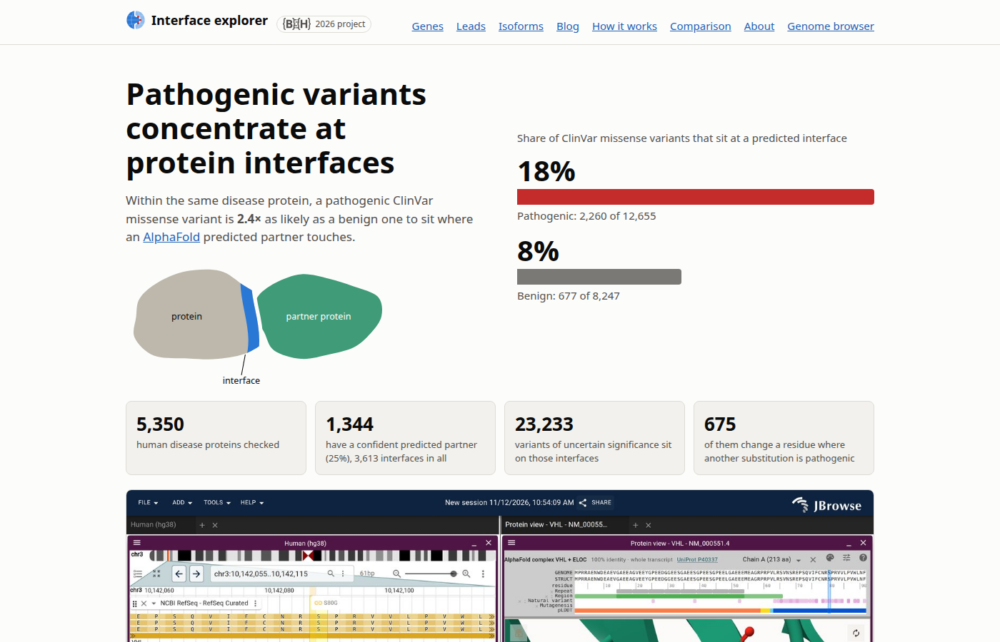

# Interface explorer

An explorer for asking which partner a disease variant might disturb. For
every human disease gene with an AlphaFold DB predicted complex, it shows which
codons sit at the interface, which ClinVar missense variants fall there, and
how each alternative isoform's predicted structure differs from the canonical
one, in 3D and on the genome. Agreement with deposited PDB structures, and the
variant statistics, are the evidence that the predicted interfaces are worth
exploring; the explorer is for exploring them.

**[Open the explorer](https://cmdcolin.github.io/interface-explorer/)**

## Docs

- [What is on the site](docs/site.md)
- [Findings and caveats](docs/findings.md): the odds ratios, conservation, experimental checks
- [Isoforms](docs/isoforms.md)
- [GPCRs and their G proteins](docs/gpcrs.md)
- [SARS-CoV-2 contacts](docs/sars-cov-2.md)
- [Method](docs/method.md): how interfaces, variants, conservation and the rest are computed
- [JBrowse tracks](docs/tracks.md)
- [Running the pipeline and site](docs/running.md)
- [Data and credits](docs/credits.md)

## Future ideas

- **Alignment as a 2D graph:** the Project 9 msa2d pages draw a family's
  alignment as a graph, with alignment columns as nodes grouped by helix and
  strand and contacts as edges, and each structure as a layer over the same
  nodes. The GPCR complexes, numbered by GPCRdb on the receptor and CGN on Gα,
  would fit that frame: receptor–Gα contacts as edges between two numbered
  graphs, and variants placed on columns shared across receptors.

- **Beyond human:** the structural core (interface calling, patch ranking,
  isoforms, the PDB check) is species-agnostic. The variant layers are not:
  ClinVar, AlphaMissense, hg38 phyloP and the hg38 JBrowse links. Another
  organism needs its own variant source (OMIA, yeast or fly mutant
  collections) and protein-alignment conservation where no genome-wide track
  exists. Mouse or yeast is the natural second species, if AlphaFold DB models
  enough of their complexes.
